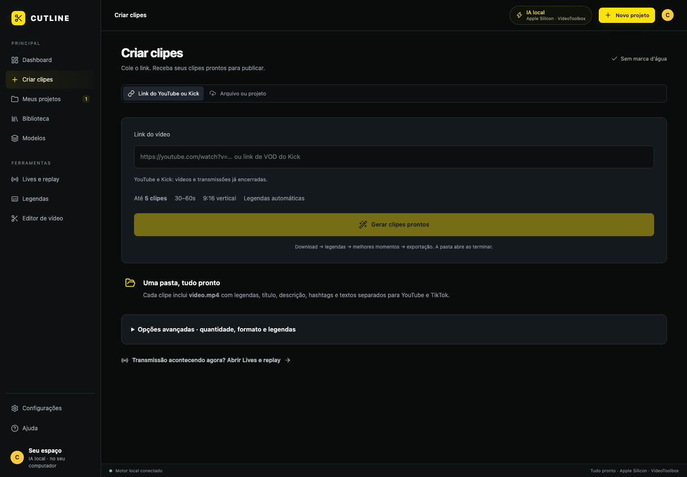
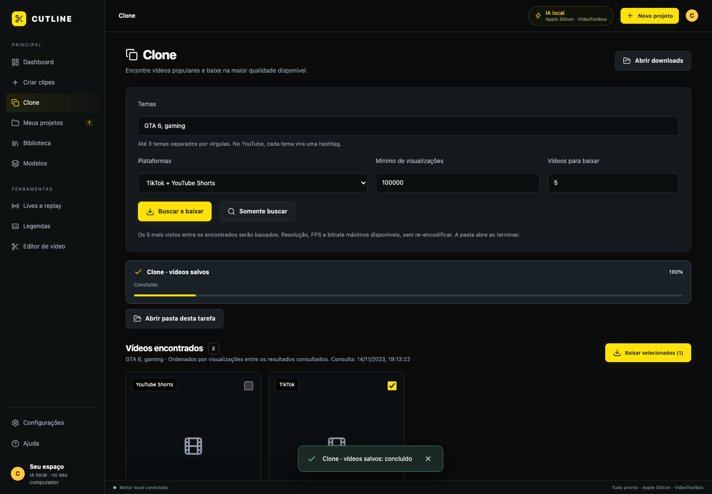

# Cutline

Rust + Tauri desktop clip studio, with a Portuguese interface based on the supplied dark/yellow references. React is used for the interface; Rust owns media processes, files, jobs, validation, and AI integration.

## Use

Open **Cutline.app**. In **Configurações**, choose **IA local** or **ChatGPT Codex**. Use **Preparar IA** once to download the speech model and, for local mode, the language model.

1. Open **Criar clipes**, paste a YouTube or Kick video/VOD link, then click **Gerar clipes prontos**.
2. Cutline downloads the video, transcribes speech, selects highlights with the chosen AI mode, burns captions, and exports the clips. Download percentage and each processing stage remain visible.
3. The output folder opens automatically in Finder / File Explorer / the system file manager. Each numbered subfolder has its MP4, title, description, hashtags, YouTube upload text, TikTok caption, and structured metadata. Review the results and upload them to your account.

Defaults: up to five vertical clips, 30–60 seconds each, automatic language detection. **Opções avançadas** changes count, duration, format, language, and caption styling. Titles and descriptions are generated in Portuguese. If the AI finds fewer usable non-overlapping moments, the completion label and manifest report the actual count.

**Arquivo ou projeto** supports local files and previously imported recordings. The manual editor remains available for adjusting intervals and captions. Manual single-clip and batch exports also open their output folder when complete.

**Lives e replay** records a currently live YouTube/Kick stream from the moment you start. Once enough completed segments exist, save the last 30 or 60 seconds. Stop saves the full recording as a project; select it under **Arquivo ou projeto** to generate an upload package.



A generated package looks like this:

```text
exports/package-<job-id>/
  LEIA-ME.txt
  manifest.json
  01/
    video.mp4
    titulo.txt
    descricao.txt
    hashtags.txt
    youtube.txt
    tiktok.txt
    metadata.json
  02/
    ...
```

`manifest.json` records completed clips and a `running`, `completed`, `failed`, or `cancelled` status. Completed clips survive failures or cancellation of later clips. A partial video is named `video.partial.mp4` until its metadata has been written. Existing exports are never overwritten. Exported videos also appear in **Biblioteca**.

The standard clip editor prepares files for manual upload. Clone also supports optional automatic uploads to connected TikTok and YouTube accounts. YouTube/TikTok text files do not configure account-specific upload settings.

## Clone: discover and download popular videos



Open **Clone** for TikTok and YouTube Shorts discovery. The defaults are **GTA 6**, at least **100,000 views**, and **five downloads**. The **Temas** field stays editable while work runs and saves edits across navigation/restarts. Enter up to three comma-separated topics (alternatives, not combined requirements), select either or both platforms, then:

- **Buscar e baixar** searches until the requested number passes verification, ranks them by reported view count, then starts the download batch.
- **Somente buscar** shows results first. Download an individual video or select up to **10,000** for a batch. **Vídeos desejados** accepts 1–10,000, applies to both search modes, and is remembered across restarts.
- **Já tem um link?** accepts a canonical public TikTok video or YouTube Shorts URL directly.

YouTube discovery uses keyword search with the Shorts filter and follows result-page continuations. TikTok discovery uses topic-preserving public Bing video queries and their available infinite-scroll links. Both expand equivalent topic names (for example GTA 6, GTA VI and Grand Theft Auto VI) and deduplicate pages/videos. There is no candidate-check or page-round budget: search continues until the configured number is approved, you cancel, or all available queries/pages are exhausted or unavailable. A partial result is reported as an incomplete search, not a completed batch; automatic downloading/uploading starts only after the requested count is reached. Partial approved results remain available for manual selection. Public search cannot guarantee 10,000 qualifying videos. Exact per-video view counts replace abbreviated search counts before approval, and cards show full numeric counts. The minimum is inclusive: 100,000 qualifies, 99,999 does not. Results are ranked within the checked sample, not across the entire platform. The summary separates below-minimum, unrelated, unavailable/failed, and session-blocked candidates and reports the actual versus requested total.

Before showing or automatically downloading a result, Clone checks its full title, description and tags for the requested topic (including GTA 6 / GTA VI / Grand Theft Auto VI aliases), downloads a disposable preview, and checks six frames across its duration with the selected AI. Hashtags alone cannot approve a candidate. Results must have a matching topic, an affirmative visual verdict, a model confidence score of at least 0.9, and an evidence explanation. Uncertain, unrelated, unavailable, and failed checks are excluded. Old results without this check are hidden. Cards display the topic, tags, and visual explanation; the download manifest retains the verdict.

Content verification uses previews of videos up to three minutes, sampled at 5%, 20%, 40%, 60%, 80%, and 95%. Previews are removed after each check, including failures/cancellation. Sampling and AI judgments are fallible: this is not proof of authenticity or a guarantee of relevance. Speech-only discussions may be excluded because this check does not transcribe audio. Fewer than the requested number may pass.

Downloads request the best available video/audio streams, prioritizing resolution, frame rate, then bitrate. There is no 1080p cap, upscale, re-encode, or watermark-removal step. Separate streams are merged losslessly into MKV when needed; a single original stream retains its available container. This uses yt-dlp's [format selection and sorting](https://github.com/yt-dlp/yt-dlp#format-selection). The best available quality can be lower than the creator's original upload.

Each batch is saved under `exports/clone-<job-id>/`. Numbered folders contain the video, `metadata.json`, the original `titulo.txt` and `descricao.txt`, and `origem.txt` with the source URL. The manifest records successful files and failures. Existing downloads survive later failures or cancellation, and successful batches open their folder automatically. **Abrir downloads** also works after restarting the app.

Clone search uses the AI selected in **Configurações**: ChatGPT Codex with the existing subscription login, or a local Ollama vision model. For local checks, select **gemma3:4b** and press **Preparar IA local**; the default text-only `gemma3:1b` cannot inspect frames. Codex mode sends the metadata and six sampled frames to OpenAI; local mode sends them only to the local Ollama server. No API key is required. Direct URL downloads skip topic verification and require no AI. Downloads use public access by default. For YouTube sign-in errors, select your signed-in browser in **Configurações → YouTube → Sessão do navegador**. Private or platform-blocked videos can still fail. The direct URL option remains available if public search returns nothing. A search HTTP request can take up to 25 seconds to return after cancellation. These original-quality downloads may need conversion through **Criar clipes → Arquivo ou projeto** for MP4 upload compatibility.

## Automatic uploads from Clone

1. In **Configurações → Upload automático**, use **Abrir login TikTok** and **Abrir login YouTube** to sign in normally in the dedicated Chrome profile. Complete platform confirmations yourself.
2. Quit that dedicated Chrome session using Chrome’s Quit command (⌘Q on macOS), then press **Verificar conexão** for each platform. The connected TikTok handle and YouTube channel identifier/name are shown. Your usual Chrome session stays separate.
3. Choose **Privado** (default) or **Público**, return to Clone, and enable **Upload automático**.
4. **Buscar, baixar e enviar** searches, verifies content, downloads an original, prepares a vertical H.264/AAC MP4, and sends it to TikTok and YouTube Shorts before continuing to the next video. Selected/direct Clone downloads follow the same toggle. **Somente buscar** never uploads.

Turning the toggle off during a batch prevents subsequent uploads; an upload already in progress may finish. Cancel stops the whole job. The app preserves originals, metadata, and successful downloads. A prepared `upload.mp4` sits alongside the original, uses the existing GPU/CPU export path, and does not add captions or alter the original file. This flow accepts videos up to three minutes and sets YouTube's audience to **not made for kids**. Titles/descriptions are taken from source metadata; review them before choosing public uploads.

The uploader uses the normal Studio browser interfaces through bundled Playwright, with Chrome and Node.js installed locally. It uses a separate persistent profile as required by [Chrome/Playwright's profile guidance](https://playwright.dev/docs/api/class-browsertype#browser-type-launch-persistent-context). Login itself opens a normal Chrome window. Account sessions remain in the private application-data directory; they are never exported, committed, sent to AI, or exposed through the app's media asset scope. No developer API credentials are required for this browser workflow.

Both accounts are checked before downloading. Each upload verifies the target account and chosen visibility and requires a success screen before recording success. History is persisted independently for each source/platform/account. Confirmed uploads are skipped on retries. If a process ends after file transfer starts without confirmation, the result is **Confira na plataforma** and automatic retry is blocked. Check the correct account in Studio; **Já foi enviado — não reenviar** records your confirmation. If you verified it was not sent, **Não foi enviado — permitir tentativa** unlocks a new attempt; **Repetir download e envio** retries a failed source and skips destinations already confirmed. Failed/uncertain jobs preserve their files and error details. There is no automatic retry of a final publish action, login challenge, or platform limit.

**Current validation limit:** browser steps were tested against controlled Studio-shaped fixtures, not by publishing to live accounts. Login, account menus, upload controls and confirmation screens can change; unsupported screens stop the task instead of claiming success. A 10,000-video selection does not override account upload limits. The history stores account identifiers and publication outcomes, not credentials. `uploads.json` corruption is reported rather than silently discarding duplicate protection.

## YouTube session

If YouTube asks to sign in, first sign into YouTube and open the video in your browser. Then choose that browser under **Configurações → YouTube → Sessão do navegador**. Cutline supports Chrome, Firefox, Edge, Brave and Safari (macOS); **Sem sessão** retains public access. Old installations default to no session until a browser is selected.

The selected browser session is passed to yt-dlp for YouTube metadata, Clone previews/original downloads, imports, and live lookup. TikTok and Kick do not receive this option. Only the browser name is saved in preferences. Cutline does not export cookies, send them to AI, or put them in output metadata. Metadata requests print an explicit public-field list instead of the full yt-dlp info object, which may contain per-format cookies. [yt-dlp browser-session documentation](https://github.com/yt-dlp/yt-dlp/wiki/FAQ#how-do-i-pass-cookies-to-yt-dlp).

If the session expires, reopen the video in the selected browser and complete any sign-in or confirmation YouTube requests, then retry. macOS may request Keychain access; some browser profiles may need to be closed while their session is read. Authentication does not guarantee access to every video or remove platform restrictions. After a session error, Clone stops YouTube verification for that search and continues TikTok if selected. Retry after renewing the session. Cutline reports actionable messages rather than repeatedly trying alternate browsers or sessions.

## AI modes

**Local:** whisper.cpp transcribes speech; Ollama ranks transcript excerpts and supplies Portuguese titles, descriptions, hashtags, and selection reasons. The default models are multilingual Whisper base (148 MB, checksum verified) and `gemma3:1b` (approximately 0.8 GB). Once installed, these models can process local files without a cloud AI service. Other already-installed Ollama models can be selected. Cutline starts a localhost-only Ollama server if needed and stops only the server it started.

**ChatGPT Codex:** Whisper still performs transcription locally. Transcript excerpts are sent through the official installed Codex CLI, using ChatGPT authentication and the account's applicable usage limits. The app uses `codex login --device-auth` when login is needed; an existing ChatGPT login is reused. Cutline never reads or copies the CLI credential file, and does not ask for an API key. The classification command requires ChatGPT authentication, removes API-key environment overrides, disables shell/browser/app/plugin features, uses a read-only sandbox, and requests schema-constrained output in an ephemeral session. [Official Codex configuration reference](https://learn.chatgpt.com/docs/config-file/config-reference).

Highlight suggestions use speech transcripts; Clone relevance checks separately inspect sampled frames. Silent gameplay and music-only videos can still be clipped manually. Requested counts are upper bounds: fewer non-overlapping highlights may be returned. Review transcription, timing, and upload text before publishing. Cancellation of a model request takes effect when the next response chunk arrives; initial model loading can take longer.

## Media and GPU behavior

- MP4, MOV, MKV, WEBM, AVI, M4V and TS input. Imports normalize to H.264/AAC for desktop preview and accurate trims.
- Original framing, square 1080×1080, or vertical 1080×1920. Square/vertical exports preserve the full foreground image over a blurred background.
- Editable automatic captions, six styles, font/color/size controls, and burned-in subtitles.
- Apple Silicon: VideoToolbox; NVIDIA: NVENC; AMD Windows: AMF; AMD/Intel Linux: VAAPI. Each advertised encoder must pass a real encoding probe. Export failures retry on CPU. Filters and caption rendering can run on CPU even with GPU encoding.
- Live capture keeps the original stream in a recoverable MKV while producing a bounded rolling buffer. Replays end at the most recent completed segment, usually a few seconds behind capture. This does not retrieve history from before recording started.
- One foreground media/AI job plus one live recording can run at a time. Closing is blocked while work is active; stop/save live recording or cancel the job first.

Private, expired, age-restricted, DRM-protected, or platform-blocked URLs may fail. Embedded players may also be blocked by the provider; **Abrir transmissão** opens the source normally. yt-dlp needs periodic updates as platforms change. [yt-dlp project](https://github.com/yt-dlp/yt-dlp).

## Requirements and development

On macOS, dependencies are installed separately from the app bundle. The app discovers Homebrew tools even when Finder has a restricted PATH:

```sh
brew install ffmpeg-full whisper-cpp ollama
npm install -g @openai/codex
```

Use a current Ollama release (`brew upgrade ollama` if a model requires a newer version). FFmpeg **must include libass** for subtitles. `ffmpeg-full` is preferred over the minimal Homebrew formula. Node is used by yt-dlp for YouTube JavaScript challenges.

To build, install Rust and the native [Tauri prerequisites](https://v2.tauri.app/start/prerequisites/), then:

```sh
npm ci
npm run tools         # official yt-dlp binary, verified against release SHA256
npm run tauri -- dev
npm run tauri -- build --bundles app   # macOS
```

The built macOS app is `src-tauri/target/release/bundle/macos/Cutline.app`. This local build uses an ad-hoc signature. It is not Developer ID signed or notarized for public distribution. FFmpeg, Whisper, Ollama and Codex are external tools; yt-dlp is bundled with its release metadata.

Windows/Linux source paths and encoder backends are included, but those platforms require native builds and their own driver/FFmpeg verification. On Windows ensure actual CLI executables are available on PATH; use the native Codex CLI executable. Use the appropriate Tauri bundle target instead of `app`.

## Files and recovery

macOS data is stored in `~/Library/Application Support/com.submundovi.cutline/`:

| Location | Contents |
| --- | --- |
| `library/`, `library.json` | Imported/recorded media, thumbnails and catalog |
| `exports/` | Finished MP4 clips and numbered upload packages |
| `transcripts/`, `highlights/` | Editable words and suggested intervals |
| `models/` | Whisper model |
| `preferences.json` | AI, encoder and caption settings; no API credentials |
| `work/` | Job files and rolling segments; interrupted recordings stay here |

Successful non-live jobs remove their temporary directories. Live buffers and failed-job work are retained so unfinished recordings are not silently lost. After stopping the app, old buffer directories without a needed `recording.mkv` can be removed manually. Long recordings and full-video imports need sufficient disk space. Original input files are never overwritten. Keep the catalog and its media together when backing up.

If a recording is interrupted, import its `work/<job>/recording.mkv` through **Criar clipes**. Completed batch clips remain in the library if a later clip fails or the job is cancelled.

## Checks

```sh
npm run build
cargo test --manifest-path src-tauri/Cargo.toml --lib
npx playwright install chromium     # if no Playwright browser is installed
npm test
cargo test --manifest-path src-tauri/Cargo.toml --test workflows import_trim_captions_batch_and_cancel -- --ignored --nocapture
cargo test --manifest-path src-tauri/Cargo.toml --test workflows rolling_buffer_and_full_recording -- --ignored --nocapture
cargo test --manifest-path src-tauri/Cargo.toml --test workflows package_files_and_partial_results_survive_failure -- --ignored --nocapture
```

Browser tests mock desktop IPC to verify UI commands, validation, save failures, AI mode switching, one-click generation, live download progress, automatic folder-opening commands, and responsive layouts. Rust workflow tests perform actual FFmpeg imports, caption/format exports, CPU retry, cancellation, and a real 60-second rolling capture. Optional `both_ai_modes`, `youtube_generates_upload_package`, and `platform_download_and_live_capture` tests require models, a ChatGPT login, and network access; see their environment variables in `src-tauri/tests/workflows.rs`.

Runtime integration references: [whisper.cpp](https://github.com/ggml-org/whisper.cpp), [Ollama API](https://github.com/ollama/ollama/blob/main/docs/api.md), [FFmpeg segment muxer](https://ffmpeg.org/ffmpeg-formats.html#segment_002c-stream_005fsegment_002c-ssegment), [NVIDIA FFmpeg guidance](https://docs.nvidia.com/video-technologies/video-codec-sdk/13.1/ffmpeg-with-nvidia-gpu/), [AMD AMF guidance](https://github.com/GPUOpen-LibrariesAndSDKs/AMF/wiki/FFmpeg-and-AMF-HW-Acceleration).
